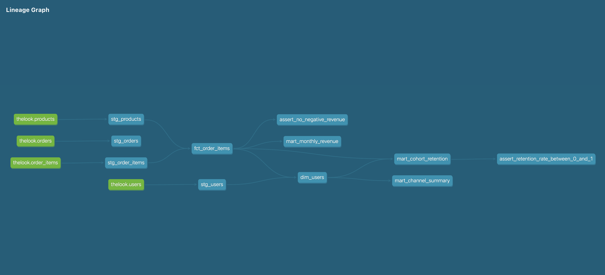
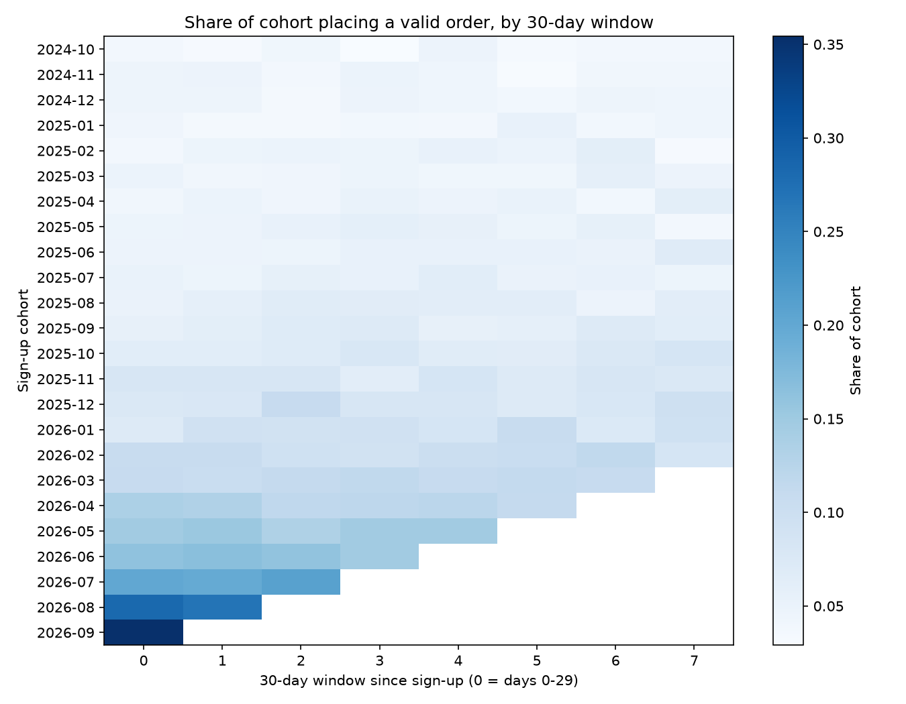
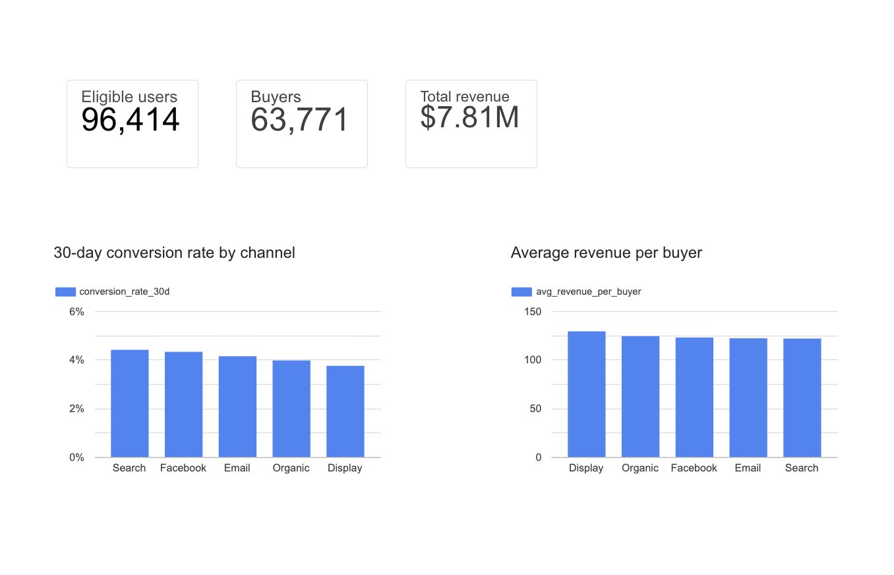
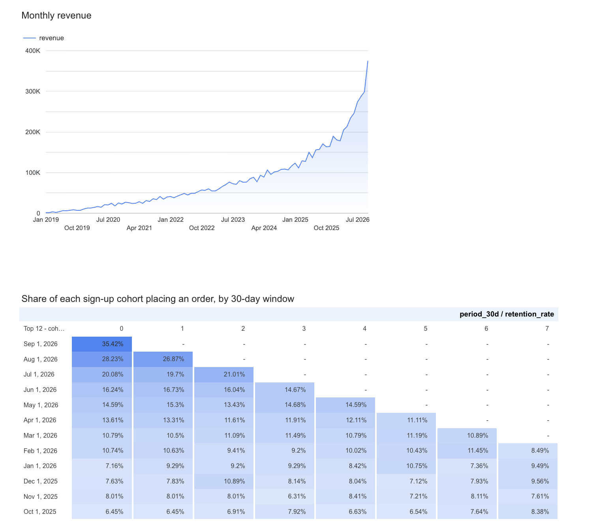

# Acquisition channel analytics on thelook_ecommerce

An end-to-end analytics project: layered dbt models on BigQuery, data-quality checks, statistical tests in Python, and a two-page dashboard.

**Dashboard:** [View the live report](https://datastudio.google.com/reporting/30a2559a-5860-4dbd-8f67-29e3167a7f7b)

## Business question
Do users from different acquisition channels differ in how often they buy, how much they spend, and how they return over time?

## Stack
BigQuery, dbt (dbt-bigquery), Python (pandas, SciPy, statsmodels, matplotlib), Looker Studio.

## Data
BigQuery public dataset `bigquery-public-data.thelook_ecommerce` (users, orders, order items, products). The data is synthetic, which affects how far the findings can be generalised (see caveats).

## Architecture



| Layer | Model | Purpose |
|---|---|---|
| Staging (views) | `stg_users`, `stg_orders`, `stg_order_items`, `stg_products` | Rename, cast, one row per entity |
| Marts (tables) | `fct_order_items` | One row per order item, with `is_valid_revenue` and `revenue` |
| | `dim_users` | One row per user, with 30-day conversion and data-quality flags |
| | `mart_cohort_retention` | Share of each sign-up cohort ordering in each 30-day window |
| | `mart_channel_summary`, `mart_monthly_revenue` | Pre-aggregated tables feeding the dashboard |

## Metric definitions
- **Valid revenue:** order items that are not Cancelled or Returned.
- **Converted (30 days):** the user's first valid order falls within 30 days after sign-up.
- **Analysis population:** users who signed up at least 30 days ago (full window observed), excluding users flagged for the data-quality issue below.
- **Cohort activity:** share of a sign-up-month cohort placing at least one valid order in a given 30-day window. This is "any valid order in the window", not repeat purchase. A window is shown only once every user in the cohort has been observed for all of it.

## Data quality
- 129 users (0.13%) have a first order dated before their sign-up, which is impossible in real data. They are flagged in `dim_users.has_order_before_signup` and excluded from the analysis.
- dbt tests cover unique and not-null keys, referential integrity between facts and users, accepted order statuses, non-negative revenue, and retention rates between 0 and 1. `dbt build` passes.

## Findings

Full analysis: [`analysis/analysis.ipynb`](analysis/analysis.ipynb)

| Comparison (Search vs Organic) | Search | Organic | Result |
|---|---|---|---|
| 30-day conversion | 4.41% | 3.97% | Difference 0.44 percentage points (95% CI 0.07 to 0.78), p = 0.019 (two-proportion z-test) |
| Mean revenue per buyer | 121.70 | 124.17 | Welch p = 0.096, Mann-Whitney p = 0.296: no evidence of a difference |

Search converts slightly better, but its buyers spend about the same, so any advantage comes from more users buying rather than larger orders.



## Dashboard




## Caveats
1. The conversion gap is statistically significant but small, and the confidence interval's lower end is close to zero.
2. This was one pre-chosen comparison. Testing all 10 channel pairs would call for a multiple-comparison correction (for example Bonferroni), under which this result would not be significant.
3. Users were not randomly assigned to channels, so this shows association, not causation.
4. The data is synthetic. Order volume per user rises over time (monthly orders grew from about 4,260 in July to 5,774 in October 2026 while sign-ups stayed flat), so cohorts are not like-for-like across months. Within-cohort patterns and channel comparisons are more reliable than cross-cohort trends.
5. Lifetime revenue depends on how long a user has existed.
6. Facebook, Email and Display were not tested.

## How to run
```bash
python3.12 -m venv venv && source venv/bin/activate
pip install dbt-bigquery pandas scipy statsmodels matplotlib jupyter google-cloud-bigquery db-dtypes
gcloud auth application-default login
cd thelook_analytics
# create a dbt profile named thelook_analytics (oauth, your GCP project, dataset thelook_dbt, location US)
dbt build
```
Then open `analysis/analysis.ipynb` and set `PROJECT` to your GCP project ID.

## What I would do next
- Schedule `dbt build` (dbt Cloud, Airflow or CI) and make large models incremental.
- Add source freshness checks.
- Extend the analysis with a multiple-comparison correction across all channel pairs.
